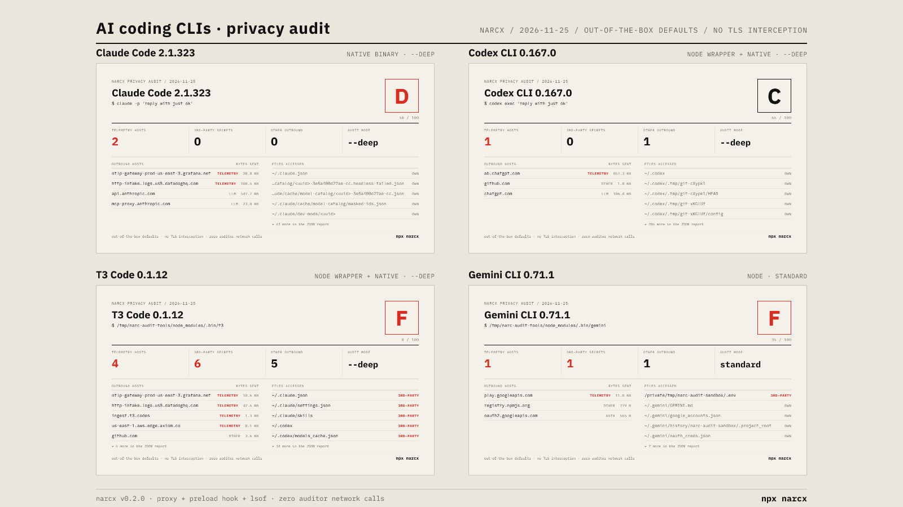

# narc



*Claude Code, Codex CLI, T3 Code and Gemini CLI audited with narcx on 2026-11-25: out-of-the-box defaults, no TLS interception, kernel-level file tracing where the binary is native. Grades: D, C, F, F.*

> npm package: **`narcx`** · installed command: **`narc`**

Catch any local CLI tool, AI coding harness or MCP server red-handed when it phones home or reads your dotfiles.

```bash
npx narcx -- <command> [args...]
```

`narc` wraps the command, watches it from three angles at once, prints live `[NARC 🚨]` alerts on stderr while the tool runs, and finishes with a box-drawn **Privacy Scorecard** (plus an optional shareable PNG and a JSON audit log). It needs no sudo, never terminates TLS, and makes zero outbound network calls of its own.

```
┌─ NARC · PRIVACY SCORECARD ───────────────────────────────────────────────────┐
│ $ shady-ai-tool  (narc --demo fixture)                                ██████ │
│ exit 0 · 1.1s · layers: proxy, preload, lsof                          █ F  █ │
│ score 0/100  (13 deductions)                                          ██████ │
├─ SENSITIVE FILES TOUCHED (8) ────────────────────────────────────────────────┤
│ ● ~/.ssh/id_rsa           SSH keys         createReadStream×1 open×1         │
│ ● ~/.aws/credentials      AWS credentials  promises.readFile×1               │
│ ● ~/.claude.json          Claude Code config readFileSync×1                  │
├─ OUTBOUND (7 hosts) ─────────────────────────────────────────────────────────┤
│ TELEMETRY (4)                                                                │
│   ● us.i.posthog.com       2 req   698 B ↑ 332 B ↓  via hook   POST /batch/  │
│   ● metrics.shady-ai.dev   1 req   1.3 KB ↑   0 B ↓  via proxy                │
│ UNKNOWN (1)                                                                  │
│   ▲ cdn.shady-ai.dev       1 req    92 B ↑ 166 B ↓  via hook   GET /update…  │
│ LLM API (2)                                                                  │
│   ✓ api.anthropic.com      1 req   188 B ↑ 166 B ↓  via hook   POST /v1/mes… │
└──────────────────────────────────────────────────────────────────────────────┘
```

## Try it in ten seconds

```bash
npx narcx --demo --card ./demo-report.png
```

`--demo` runs a built-in mock "shady-ai-tool" against a throwaway fake HOME full of decoy secrets. Every "vendor" it contacts is a loopback sink, so nothing leaves your machine, yet every layer fires and you get an `F`.

## Usage

```bash
npm i -g narcx     # or just use npx narcx
```

```
narc [options] -- <command> [args...]

  --card [path]     Save a 1200x675 dark-mode Privacy Scorecard PNG (default ./narc-report.png)
  --json [path]     Export the raw audit log as JSON (default ./narc-report.json)
  --deep            Kernel-level tracing: fs_usage on macOS (asks for sudo), strace -f on Linux
  --demo            Run the built-in mock shady-ai-tool
  --render <json>   Re-render the scorecard (terminal + --card PNG) from a saved --json report
  --regrade <json>  Rebuild a saved report's summaries and grade from its events under the current rules
  --title <text>    Headline for the card, e.g. "Claude Code 2.1.323"
  --footer <text>   Left footer line on the card, for variant runs (e.g. "T3CODE_TELEMETRY_ENABLED=false · …")
  -v, --verbose     Also show LLM API traffic, other dotfile reads and repeat requests live
  -q, --quiet       No live alerts, only the exit scorecard
  --include-children  Grade external CLIs the tool spawns as if the tool did it (default: excluded, reported)
  --no-lsof         Disable the lsof socket poller
  --interval <ms>   lsof poll interval (default 150)
```

Examples:

```bash
narc -- npx some-ai-cli --help
narc --card --json -- claude -p "summarise this repo"
narc -v -- node ./my-mcp-server.js
narc --deep -- ./some-go-binary serve
```

The child's stdin/stdout/stderr are inherited untouched, so interactive tools keep working. `narc` exits with the child's exit code (or `128 + signal`). Ctrl-C is forwarded to the child; a second Ctrl-C kills it.

## How it watches (no sudo required)

| Layer | Mechanism | What it sees |
| --- | --- | --- |
| 1. Proxy sniffer | Ephemeral HTTP + HTTPS `CONNECT` proxy on `127.0.0.1`, injected via `HTTP_PROXY` / `HTTPS_PROXY` / `ALL_PROXY` (and lower-case twins, `NO_PROXY=""`, `NODE_USE_ENV_PROXY=1`) | Plain HTTP: host, method, path, bytes. HTTPS: `CONNECT` host, port and tunnel byte volume only. TLS is never broken, so cert pinning keeps working. |
| 2. Preload hook | A tiny CommonJS script injected with `NODE_OPTIONS="--require …"` (existing `NODE_OPTIONS` preserved). Patches `fs.readFile`, `readFileSync`, `open`, `openSync`, `createReadStream`, `readdir(Sync)`, `fs.promises.readFile/open/readdir`, `http(s).request/get`, `globalThis.fetch` and `dns.lookup`. Streams NDJSON events to narc over a Unix domain socket (loopback TCP fallback). | Exact full URLs including paths like `/v1/ingest`, methods, request/response byte sizes, and exact sensitive file paths in any Node child or grandchild. Zero cert errors. |
| 3. OS fallback | `lsof -i -n -P` polled every 150 ms over the child's process tree (`-n -P` so lsof itself never does DNS). With `--deep`: `strace -f -e trace=openat,connect` on Linux, `fs_usage -w -f filesys` on macOS. | Raw sockets from Go/Rust/Python binaries that ignore proxy env vars; with `--deep`, file opens from any binary. |

Events from several layers about the same host are merged. Request counts and bytes come from the highest-fidelity source that saw the host (hook > proxy > strace/fs_usage > lsof), and the scorecard tells you which (`via hook+lsof`). IPs seen only by lsof are mapped back to hostnames when the hook observed the DNS lookup; otherwise they are listed as the bare IP.

All child processes, temp files, the proxy and the IPC socket are torn down on exit, `SIGINT`, `SIGTERM` and `SIGHUP`.

## What gets flagged

**Secrets vs configs.** Only files that actually hold credentials are graded as third-party secrets: `.env` and `.env.*` (not `.env.example`/`.sample`/`.template`), SSH private keys (not `*.pub`, `known_hosts`, `config`), `~/.aws/credentials`, `~/.kube/config`, `~/.netrc`, `~/.npmrc`, `~/.pypirc`, `~/.docker/config.json`, `~/.git-credentials`, `~/.config/gh/hosts.yml`, another tool's credential store (`~/.claude/.credentials.json`, `~/.codex/auth.json`, `~/.gemini/oauth_creds.json`), and generic names such as `*credentials*`, `*_creds.json`, `*token*.json`, `*.pem`, `*.key`, `*.p12`, `id_rsa`, `id_ed25519` outside package and cache trees. Another tool's settings, prompts, caches and directory listings (`~/.claude.json`, `~/.claude/settings.json`, `~/.claude/skills`, `~/.codex/config.toml`, `~/.codex/models_cache.json`, `~/.gemini/GEMINI.md`, `~/.gitconfig`, …) are still listed, with a muted `CONFIG` tag, but cost nothing.

**Watchlist** (what is matched at all): `~/.claude.json`, `~/.claude/**`, `~/.codex/**`, `~/.cursor/**`, `~/.gemini/**`, `~/.config/opencode/**`, `~/.local/share/opencode/**`, `~/.config/gh/**`, `~/.ssh/**`, `~/.aws/**`, `~/.gitconfig`, `~/.npmrc`, `~/.netrc`, `~/.pypirc`, `.env`, `.env.*` (anywhere), `~/.gnupg/**`, `~/.docker/config.json`, `~/.kube/**`, `~/.config/gcloud/**`, macOS keychains, and Chrome/Chromium/Brave/Edge/Arc/Firefox/Safari cookie and login stores.

When the command is a package runner (`npx`, `pnpm dlx`, `bunx`, `uvx`, …), the runner's own activity (registry lookups, `~/.npmrc`, `~/.gitconfig`) is attributed by pid, shown dimmed as `via npx · not graded`, and excluded from the grade. Anything the tool's own processes do is still graded.

Coding agents (`claude`, `codex`, `gemini`, `cursor`, `opencode`, `t3`, `aider`, `copilot`, …) may read `~/.gitconfig` without penalty: git identity is part of their job, exactly as it is for `git` itself. Every other tool reading it is still flagged. `--regrade report.json` re-derives a saved report's summaries and grade from its recorded events under the current rules, so old audits can be re-scored after a rules change without re-running the tool.

Reads inside the tool's **own namespace** are listed with an `OWN CONFIG` label and not penalised: running `claude` may read `~/.claude.json`, `gh` may read `~/.config/gh`, `git` may read `~/.gitconfig` and `~/.ssh`, `npm`/`npx` may read `~/.npmrc`, and so on. Other dotfiles under `~` are kept in the JSON as low-priority context.

**Domain classifier**

- Loopback (`127.0.0.1`, `::1`, `localhost`) is never an outbound host and is dropped entirely.
- `LLM` (never penalised): `api.anthropic.com`, `mcp-proxy.anthropic.com`, `api.openai.com`, `chatgpt.com`, `generativelanguage.googleapis.com`, `cloudcode-pa.googleapis.com`, `openrouter.ai`, `api.githubcopilot.com` and a few other model backends, matched exactly or as subdomains.
- `AUTH` (never penalised): `oauth2.googleapis.com`, `accounts.google.com`, `auth.openai.com`, `console.anthropic.com`, …
- `TELEMETRY` (red, −25 each): `posthog.com`, `sentry.io`, `segment.io`, `segment.com`, `mixpanel.com`, `amplitude.com`, `datadoghq.com`, vendor metrics endpoints such as `ab.chatgpt.com` (Codex's Statsig/OTLP endpoint) and `play.googleapis.com` (Google Clearcut), observability/error-reporting vendors (`grafana.net`, `honeycomb.io`, `newrelic.com`, `bugsnag.com`, `axiom.co`, `google-analytics.com`, …) and their subdomains; any host with a `telemetry`, `ingest`, `analytics`, `metrics`, `statsig`, `launchdarkly`, `otlp` or `otel` label; and generic hosts on known logging paths when the path is visible. Telemetry rules win over the LLM list, so `ab.chatgpt.com` is red while `chatgpt.com` is not.
- `OTHER` (yellow, −10 each): everything else, including package registries and update servers. Decide for yourself.
- Raw IPs seen only by the lsof poller while the proxy was already naming hosts in the same run are reported as *suppressed* and not graded: they are almost always the same connections seen twice.

**Grade**: start at 100, then −25 per telemetry host, −30 per sensitive file read outside the tool's own namespace, −10 per unknown host. `A+` 100 · `A` 90+ · `B` 80+ · `C` 65+ · `D` 50+ · `F` below 50.

## Target vs. child: who actually did it

Every event is attributed to the process that caused it. The audited tool and whatever it ships (wrapper scripts, bundled native binaries, its own helper processes) are **target**; any external CLI it spawns, such as `claude`, `codex`, `gemini`, `git`, `gh` or `npm`, is a **child**. The install root is derived from the command (`fs.realpathSync` of the executable or entry script, then the nearest package root or a directory named after the tool), and anything running from under it, or carrying the tool's name, stays target.

Child activity is reported in full, in the JSON (`childActivity`, grouped by child binary, plus `attribution`/`processName`/`via` on every host, file and event), in a muted terminal section, and as a one-line callout on the card, but it is **excluded from the grade**: an orchestrator like T3 Code is not penalised because the Claude Code it launched phoned Datadog, and `codex` reading `~/.codex/auth.json` is codex's business. Pass `--include-children` to fold children back into the score.

The proxy attributes each connection to the process that opened it by resolving the client's ephemeral port the moment the connection arrives (`lsof -sTCP:ESTABLISHED`, `/proc/net/tcp` on Linux), holding the upstream leg for up to 80 ms so even a fast-exiting client is still established when `lsof` looks; the hook reports its pid and executable; `lsof`, `strace` and `fs_usage` carry pids or accounting names. When a pid still cannot be resolved, the host goes to a well-known child CLI only if that CLI was observed in the tree (`cafe.github.com` → `gh`, Datadog and Grafana → `claude`, `chatgpt.com` → `codex`), and otherwise is reported as **unattributed** and left out of the grade.

Hosts named in your own `OTEL_EXPORTER_OTLP_*` environment are tagged `USER OTLP` and never penalised: exporting your own traces is your choice, not vendor telemetry.

## Honest file-read coverage

Files are attributed to the process that opened them, using the kernel accounting name and, for interpreters, the script they run (`node npm-cli.js` is `npm`). A helper reading its own namespace (`git` → `~/.gitconfig`, a spawned `codex` → `~/.codex/**`) is own config; the audited tool reading another tool's files is third-party. Opens that fail (the path does not exist) are listed as *probed*, never graded, whether the hook or `fs_usage` saw them.

The preload hook only sees Node processes. If the audited tool is a native (Bun/Rust) binary and `--deep` is off, narc reports **file reads not traced** rather than a clean sheet, the `3RD-PARTY SECRETS` metric shows `—`, and the JSON carries `fileTracing: { mode, coverage, untraced }`. A Node wrapper around a native binary (Codex) is reported as *partial* with the unhooked executable named.

## The PNG scorecard

`--card` renders a 1200×675 Swiss-editorial audit sheet: warm paper (`#F4F1EA`), hairline rules, tabular IBM Plex Mono data, vermilion only for telemetry, third-party secret reads and D/F grades. Hand-built SVG rasterised with `@resvg/resvg-js`; no Puppeteer, Playwright or canvas binaries. IBM Plex Sans and IBM Plex Mono (SIL OFL) are bundled in `assets/fonts/` and passed to resvg explicitly so the card renders identically on every machine. `--title "Claude Code 2.1.323"` sets the sheet's headline; `--render report.json --card out.png` re-renders a saved report.

## Guardrails

- `narc` makes no outbound network calls. Everything binds to `127.0.0.1`; `lsof` runs with `-n -P`; no reverse DNS, no update checks, no telemetry. Audit it: `grep -rn "http" src/` finds only the local proxy and the demo sinks.
- Two runtime dependencies: `picocolors` and `@resvg/resvg-js`, plus ~1 MB of bundled OFL fonts.
- The preload hook never throws into the host program. Every patch is wrapped so a failure inside narc falls through to the original call.

## Limitations worth knowing

- Node's built-in `fetch` and `http` ignore proxy env vars before Node 24, which is why layer 2 exists. Non-Node tools that ignore proxies are only seen by `lsof` (host IP, port, no path), or by `--deep`.
- `lsof` polling can miss connections shorter than the poll interval. Lower `--interval` if you need more; it costs one `ps` and one `lsof` spawn per tick.
- Bytes for `CONNECT` tunnels are TLS record bytes, slightly larger than the payload. Bytes from the hook are plaintext request/response bytes on the socket.
- `--deep` on macOS: `fs_usage` cannot follow forks, so narc traces system-wide and filters by process name, the only identity `fs_usage` prints. Another process with the same name as something in the child's tree can be mis-attributed. Paths wider than the `fs_usage` column are left-trimmed and rebuilt under `$HOME`. If you run `sudo narc --deep …`, the traced command is spawned as `$SUDO_USER` with that user's HOME.
- `--deep` on Linux needs `ptrace` permission (often blocked in containers); narc checks and falls back silently.

## Development

```bash
npm install
npm run build        # tsup -> dist/cli.js (ESM, shebang), dist/preload.cjs, dist/shady-ai-tool.cjs
npm test             # vitest: classifier, watchlist matcher, grading, collector, lsof/strace/fs_usage parsers
npm run demo         # node dist/cli.js --demo --card ./demo-report.png
```
